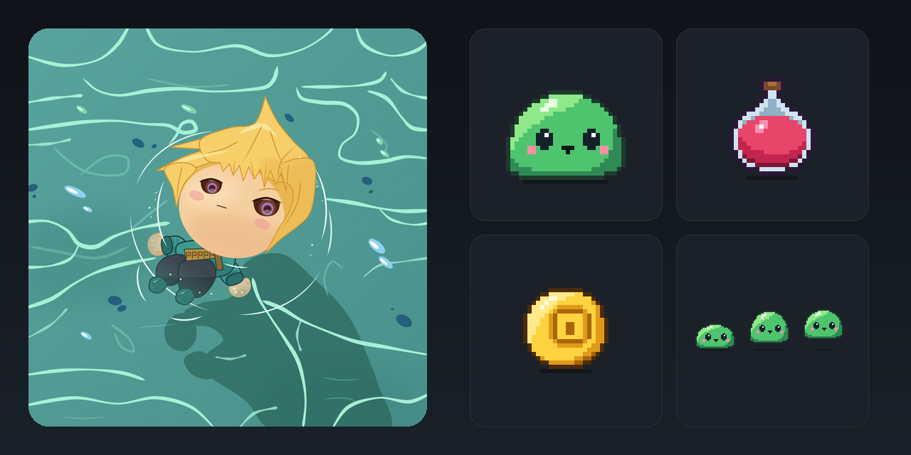
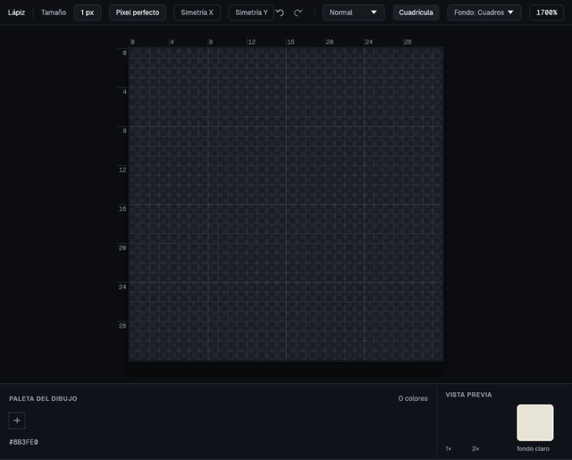
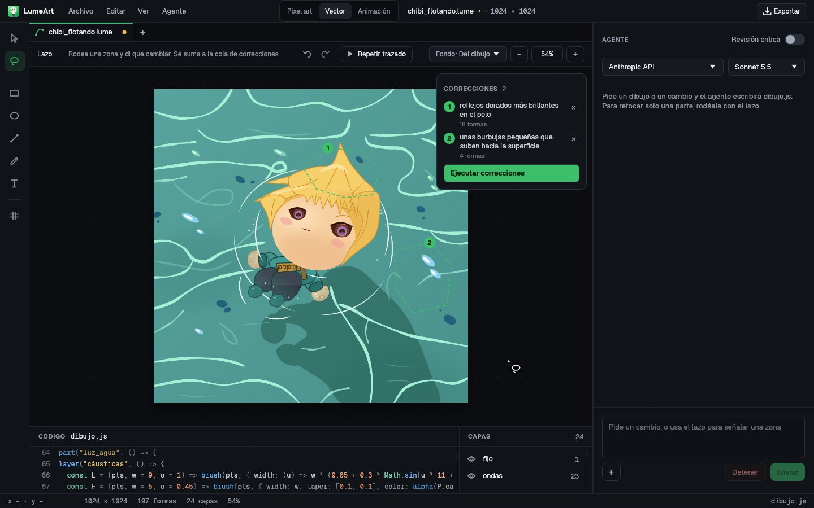
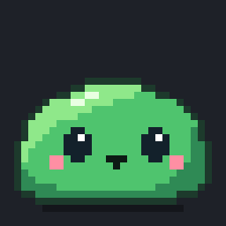
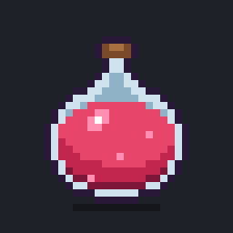
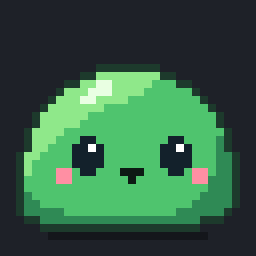
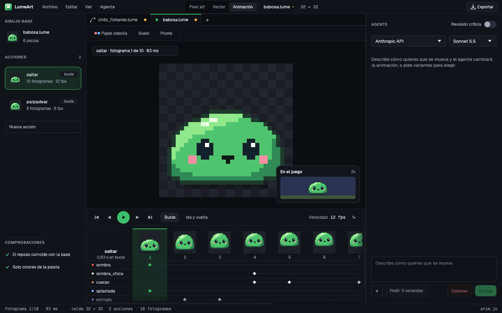

<p align="center">
  
</p>

<h1 align="center">LumeArt</h1>

<p align="center">
  <b>El estudio de arte de tu videojuego, con un agente de IA que dibuja contigo.</b><br>
  Pixel art, ilustración vectorial y animación en un solo programa para Linux, Windows y macOS.
</p>

<p align="center">
  <a href="#pixel-art">Pixel art</a> ·
  <a href="#vector">Vector</a> ·
  <a href="#animación">Animación</a> ·
  <a href="#el-agente">El agente</a> ·
  <a href="#desde-tu-juego">Desde tu juego</a> ·
  <a href="#cómo-instalarlo">Cómo instalarlo</a>
</p>

<p align="center">
  
</p>

Describe lo que necesitas («una poción roja de 32×32», «que el personaje
pestañee») y el agente lo dibuja delante de ti, paso a paso. Mira el
resultado, apunta qué falta y lo corrige en varias vueltas, y cada vuelta
queda como una versión a la que puedes volver. Tú retocas a mano o señalas
con el lazo lo que quieres cambiar. Cuando está listo, lo exportas a PNG,
hoja de sprites, GIF, SVG, PDF o directamente a Godot.

Todo el arte de esta página está hecho con LumeArt.

## Pixel art

<p align="center">
  
</p>

Un editor de pixel art completo en el que el agente dibuja como lo harías tú:
comando a comando, con un pincel que ves moverse por el lienzo, mientras la
paleta del dibujo y la vista previa a tamaño real se van llenando.

- **Herramientas de siempre**: lápiz, borrador, relleno, línea, rectángulo,
  elipse, cuentagotas, selección y mover, con simetría horizontal y vertical
  y modo *píxel perfecto*.
- **Paletas fijas** (PICO-8, Game Boy) o libre, y el tamaño que quieras
  (hasta 512×512), con proporciones de un clic (1:1, 4:3, 16:9…).
- **Vista previa** a 1× y 2× sobre fondo claro u oscuro, para ver el sprite
  como se verá en el juego.
- **Exporta** a PNG a la escala que quieras (2×, 8×, 16×…).

## Vector

<p align="center">
  
</p>

Ilustraciones a cualquier tamaño: personajes, objetos, fondos, portadas. El
dibujo es código (`dibujo.js`), así que el agente lo escribe y lo corrige con
precisión, y tú ves al momento qué línea dibuja cada forma.

- **Corrige con el lazo**: rodea una zona, escribe qué cambiar («reflejos
  dorados más brillantes en el pelo») y sigue con la siguiente. Las
  correcciones se ponen en cola, numeradas, y cuando las tienes todas pulsas
  **Ejecutar correcciones**: el agente las hace en una sola pasada, cada una
  solo en su zona.
- **Dibuja tú también**: rectángulo, elipse, línea, pincel y texto, con
  relleno, borde y grosor. Lo que dibujas pasa al código y se deshace como
  cualquier cambio.
- **Capas** que se ocultan al instante, **Repetir trazado** para ver cómo se
  construyó el dibujo forma a forma, y el código con resaltado al lado.
- **Exporta** a SVG, PNG, PDF con capas e Illustrator (`.ai`), o a Godot como
  escena (una capa por plano, con parallax).

## Animación

### Sprites de pixel art

<table align="center">
  <tr>
    <td align="center"><br><sub>saltar · 10 fotogramas</sub></td>
    <td align="center"><br><sub>burbujear · 9 fotogramas</sub></td>
    <td align="center"><br><sub>girar · 6 fotogramas</sub></td>
    <td align="center"><br><sub>parpadear · 8 fotogramas</sub></td>
  </tr>
</table>

Parte de un dibujo que ya tienes, así que cada fotograma es coherente con él.
Pide «que la babosa salte aplastándose al caer» y el agente divide el sprite
en piezas y escribe cada acción.

<p align="center">
  
</p>

- **Acciones** (reposo, andar, saltar, atacar…) con su número de fotogramas y
  su velocidad, en bucle o una vez.
- **Línea de tiempo** por piezas, papel cebolla, suelo y pivote, y una vista
  **En el juego** que lo enseña a tamaño real sobre un escenario.
- **Comprobaciones** automáticas: que el reposo coincida con el dibujo, que no
  salgan colores fuera de la paleta, que nada se salga de la celda.
- **Variantes**: pide tres versiones de una acción y quédate con la mejor (o
  mezcla lo mejor de cada una).
- **Exporta** a hoja de sprites (con su `.json`), tiras por acción, GIF o un
  `SpriteFrames` de Godot listo para `AnimatedSprite2D`.

### Personajes vectoriales con esqueleto

<p align="center">
  
</p>

Los dibujos vectoriales se animan con huesos: cada parte (un brazo, un
mechón, un ojo) cuelga de su hueso, y cada acción dice cómo gira, se mueve, se
estira o se desvanece cada uno. Este personaje flota, rema con brazos y
piernas, pestañea y mueve el pelo con el agua, con ondas que nacen de su
cuerpo y se apagan.

- Pídeselo al agente («que pestañee y que el pelo se mueva con el agua») y
  ajusta después los tiempos en la línea de tiempo.
- **Exporta** a GIF o a hoja de sprites, o a Godot como personaje completo:
  `Skeleton2D` con sus huesos, un `Sprite2D` por pieza y las acciones en un
  `AnimationPlayer`.

## El agente

- **Usa la IA que ya tienes**: tu suscripción de **Claude Code** (sin claves)
  o una clave de **Anthropic** u **OpenAI**. Las claves se guardan en el
  llavero del sistema, nunca en archivos.
- **Trabaja por vueltas**: dibuja, mira el resultado, apunta qué falta y lo
  corrige. Cada vuelta es una versión que puedes ver y recuperar, y con la
  **revisión crítica** otro modelo revisa cada vuelta antes de darla por
  buena.
- **Puedes hablarle mientras trabaja**: lo que escribes entra en la vuelta
  siguiente. Adjunta imágenes de referencia o pégalas con Ctrl+V.
- **Varias piezas a la vez**: cada pestaña tiene su propio agente. Pide la
  poción en una, el cofre en otra y sigue dibujando en una tercera mientras
  tanto; la pestaña que trabaja lo indica con un círculo que gira.
- **No pierdes nada**: las pestañas se guardan solas cada pocos segundos y
  vuelven al abrir LumeArt.

## Desde tu juego

¿Haces tu juego con Claude Code o Codex? Conéctalos a LumeArt y pídeles el
arte sin salir de tu sesión:

```bash
lumeart setup        # registra LumeArt en Claude Code y Codex (servidor MCP y skill)
cd mi-juego
lumeart init         # crea lumeart.toml: estilo, tamaño, paleta y carpeta del arte
```

Después basta con pedir «usa LumeArt para crear el sprite del cofre» o «haz
la moneda, la poción y la llave en 32×32». LumeArt los dibuja a la vez, cada
uno en su pestaña si tienes la ventana abierta, y deja los `.png` y los
`.lume` en la carpeta de arte del juego. Tu agente también puede dibujar él
mismo en el documento abierto, revisarlo en imágenes y exportarlo.

Cómo funciona, cómo registrarlo a mano y qué hacer si algo falla:
[Conectar LumeArt con tu LLM](docs/conectar-tu-llm.md).

## Cómo instalarlo

Descarga el paquete de tu sistema de la
[última versión publicada](https://github.com/ricardoalmira89/lumeart/releases/latest).
Es un solo programa: no hace falta instalar nada más.

| Sistema | Archivo |
| --- | --- |
| Windows 10/11 (x64) | `lumeart-<versión>-windows-x86_64.zip` |
| macOS con Apple Silicon (M1, M2…) | `lumeart-<versión>-macos-aarch64.zip` |
| macOS con Intel | `lumeart-<versión>-macos-x86_64.zip` |
| Debian, Ubuntu y derivados | `lumeart_<versión>_amd64.deb` |
| Otros Linux (x86_64) | `lumeart-<versión>-linux-x86_64.tar.gz` |

**Windows.** Descomprime el `.zip` y abre `lumeart.exe`. Si SmartScreen
avisa de que la aplicación no es conocida, elige **Más información →
Ejecutar de todas formas**. Para usarlo desde la terminal (y desde Claude Code
o Codex), añade su carpeta al `PATH`.

**macOS.** Descomprime el `.zip` y arrastra `LumeArt.app` a Aplicaciones. La
app aún no está notarizada: la primera vez, haz clic derecho en ella →
**Abrir**, o ejecuta `xattr -dr com.apple.quarantine /Applications/LumeArt.app`.
Para usarlo desde la terminal:

```bash
sudo ln -s /Applications/LumeArt.app/Contents/MacOS/lumeart /usr/local/bin/lumeart
```

**Debian y Ubuntu.** Instala el paquete; queda en el menú de aplicaciones con
su icono y como `lumeart` en la terminal:

```bash
sudo apt install ./lumeart_<versión>_amd64.deb
```

**Otros Linux.** Descomprime el `.tar.gz` y copia el ejecutable, el lanzador
y el icono:

```bash
tar -xzf lumeart-<versión>-linux-x86_64.tar.gz
cd lumeart-<versión>-linux-x86_64
install -Dm755 lumeart ~/.local/bin/lumeart
install -Dm644 lumeart.desktop ~/.local/share/applications/lumeart.desktop
install -Dm644 icon-256.png ~/.local/share/icons/hicolor/256x256/apps/lumeart.png
```

Comprueba las descargas con el `SHA256SUMS` de la publicación. Para el
agente necesitas [Claude Code](https://claude.com/claude-code) instalado con
tu sesión iniciada, o una clave de Anthropic u OpenAI.

¿Prefieres compilarlo tú? Con Rust estable: `cargo install --git
https://github.com/ricardoalmira89/lumeart lumeart` (en Linux, ver las
librerías que necesita en [docs/07-desarrollo.md](docs/07-desarrollo.md)).

## Primeros pasos

1. Abre LumeArt (`lumeart` en la terminal o desde el menú de aplicaciones).
2. En **Inicio**, crea un pixel art, un dibujo vectorial o una animación del
   tamaño que quieras, o abre un archivo.
3. Elige el proveedor del agente en **Ajustes** (`Ctrl+,`).
4. Escribe en el panel de la derecha lo que quieres y pulsa **Enviar**.
5. Retoca, corrige con el lazo o pide otra vuelta, y exporta con **Exportar**.

Los dibujos se guardan como `.lume`: un solo archivo con el lienzo, el
historial, las versiones y el código del dibujo y de la animación.

## La línea de órdenes

Todo lo que hace la ventana se puede hacer también desde la terminal o un
script:

```bash
lumeart start --headless --size 32x32     # una sesión sin ventana
lumeart fill_rect 4 4 24 24 "#8b3fe0"     # ok
lumeart export --scale 10 pocion.png
lumeart stop
```

| Comando | Para qué |
| --- | --- |
| `lumeart vec …` | Dibujos vectoriales: comprobar, renderizar, SVG, PDF, Illustrator, Godot, poses del esqueleto |
| `lumeart anim …` | Animaciones de pixel art: comprobar, hoja de revisión, fotogramas, exportar (hoja, tiras, `.json`, Godot) |
| `lumeart mcp` | El servidor MCP para otros agentes |
| `lumeart setup` | Lo registra en Claude Code y Codex |

`lumeart <comando> --help` explica cada uno. El protocolo de comandos está en
[docs/06-protocolo.md](docs/06-protocolo.md).

## Desarrollo

LumeArt está escrito en Rust (11 crates, arquitectura hexagonal). Cómo
compilarlo, probarlo y publicar una versión:
[docs/07-desarrollo.md](docs/07-desarrollo.md). La arquitectura:
[docs/03-arquitectura.md](docs/03-arquitectura.md); el porqué de cada
decisión: [docs/02-decisiones.md](docs/02-decisiones.md).

```bash
cargo run -p lumeart            # el studio
cargo test --workspace
```

## Licencia

Con licencia, a tu elección, de:

- Apache License, Version 2.0 ([LICENSE-APACHE](LICENSE-APACHE))
- MIT license ([LICENSE-MIT](LICENSE-MIT))
