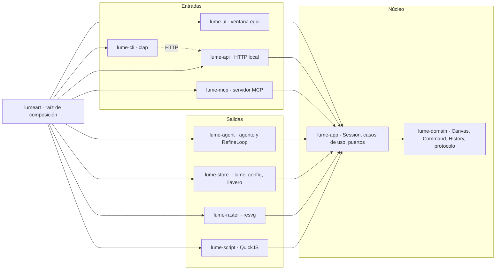
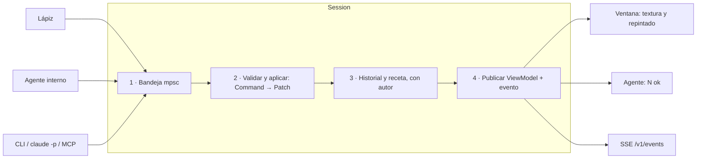
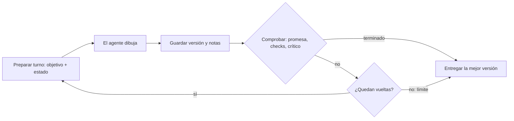

# 03 · Arquitectura interna

## Principios

LumeArt es una **arquitectura hexagonal** (puertos y adaptadores): un núcleo de
dominio puro en el centro y adaptadores intercambiables alrededor.

1. **Un único dueño del estado.** Cada documento abierto vive en una `Session`,
   la única que lo modifica. Ventana, CLI, API, MCP y agente le envían mensajes.
2. **Todo cambio es un comando** (patrón Command). Da deshacer/rehacer, la
   receta para animar y el registro de lo que hizo el agente con un solo mecanismo.
3. **El dominio no sabe nada del exterior.** `lume-domain` no depende de egui,
   tokio, HTTP ni del sistema de archivos.
4. **Los clientes son simétricos.** Lápiz, agente interno y agente externo usan
   el mismo protocolo de comandos.
5. **Lo variable va detrás de una interfaz** (patrón Strategy): proveedores de
   IA, modos del studio y herramientas son *traits*.

## Capas y crates



Cada flecha es una dependencia de código: todas apuntan hacia el dominio. La CLI
no usa la aplicación: habla con la API local por HTTP.

| Crate | Capa | Responsabilidad | Puede depender de |
| --- | --- | --- | --- |
| `lume-domain` | Dominio | Lienzo, color, paleta, documento, `Command`, historial, protocolo de texto, modelo de animación | Nada interno. Externos: solo `serde`, `thiserror` |
| `lume-app` | Aplicación | `Session`, casos de uso, eventos, `ViewModel` y los *traits* de los puertos (`DocumentStore`, `Rasterizer`, `ScriptEngine`, `AgentRunner`, `ModelProvider`, `SecretStore`) | `lume-domain` |
| `lume-script` | Adaptador | Motor JS `rquickjs`: sandbox, límites, `prelude.js`, `lib.js` | `lume-app`, `lume-domain` |
| `lume-raster` | Adaptador | SVG → PNG con `resvg`, escalado, rejilla, recortes | `lume-app`, `lume-domain` |
| `lume-store` | Adaptador | Formato `.lume`, PNG, recientes, `config.toml`, llavero (`keyring`) | `lume-app`, `lume-domain` |
| `lume-agent` | Adaptador | Runners, proveedores, herramientas, `RefineLoop`, crítico | `lume-app`, `lume-domain` |
| `lume-api` | Adaptador | HTTP local `axum` para CLI y agentes externos | `lume-app`, `lume-domain` |
| `lume-mcp` | Adaptador | Servidor MCP `rmcp` (stdio) | `lume-app`, `lume-domain` |
| `lume-ui` | Adaptador | Ventana `eframe`/`egui` | `lume-app`, `lume-domain` |
| `lume-cli` | Adaptador | Comandos `clap`, cliente de `lume-api` | `lume-domain` |
| `lumeart` | Raíz | `main`: configura, crea adaptadores, inyecta, arranca | Todos |

`crates/lumeart/tests/arquitectura.rs` comprueba estas reglas. **No se toca para
que pase**: se arregla la dependencia.

Dependencias externas: se declaran en `[workspace.dependencies]` del
`Cargo.toml` raíz y los crates las usan con `nombre.workspace = true`.

## Modelo de dominio

| Tipo | Qué es | Notas |
| --- | --- | --- |
| `Rgba` | Color de 8 bits por canal | Parseo `#rgb`, `#rrggbb`, `#rrggbbaa` y nombres (ver `06-protocolo.md`); formato canónico `#rrggbbaa` |
| `Canvas` | Búfer RGBA W×H, transparente al crear | `get`, `set`, `fill_rect`, `line` (Bresenham), `clear`; devuelven las celdas cambiadas o un error con código |
| `Palette` | Colores ordenados con nombre opcional | Derivada del lienzo o fija (PICO-8, Game Boy…) |
| `Command` | Un cambio del documento | Ver abajo |
| `Patch` | Celdas cambiadas con color anterior y nuevo | Base del deshacer |
| `History` | Pila de entradas `{patch, origin, label}` | Transacciones; deshacer/rehacer |
| `Recipe` | Comandos que reconstruyen el lienzo | Base de la animación |
| `Animation` | Piezas, reposo, `Action`s | `Action`: nombre, fotogramas, fps, bucle/una vez, duración por fotograma, `anim.js` |
| `Version` | Instantánea numerada con autor y mensaje | «Versión N», comparar, volver, vueltas del bucle |
| `Document` | Raíz | Metadatos, `Canvas`, `Palette`, `Recipe`, `History`, `Animation?`, `Version`s |

### Formato `.lume`

ZIP con nombres legibles:

- `manifest.json`: `format` (versión), tamaño, paleta, acciones, versiones.
- `canvas.png`: lienzo actual.
- `recipe.txt`: comandos en el protocolo de texto (como `lumeart batch`).
- `anim.js`: código de animación, si existe.
- `versions/NNN.png`, `versions/NNN.txt`: cada versión.
- `notas.md`: notas del agente entre vueltas del bucle.
- `agent/`: conversación con el agente.

`format` permite migrar al abrir. Importación directa de pxcli: carpeta con
`final.png` + `recipe.txt`.

## Comandos, historial y receta

```rust
pub enum Command {
    SetPixel { x: u32, y: u32, color: Rgba },
    FillRect { x: u32, y: u32, w: u32, h: u32, color: Rgba },
    Line { from: (u32, u32), to: (u32, u32), color: Rgba },
    Clear { color: Option<Rgba> },
    Resize { w: u32, h: u32 },
    Batch(Vec<Command>),
}
```

- **Un solo protocolo.** El texto se parsea a `Command` en `lume-domain` con los
  códigos de error de pxcli. El lápiz crea el `Command` directamente.
- **`apply` devuelve un `Patch`** con solo las celdas cambiadas; deshacer aplica
  el patch al revés. Nada de copiar lienzos enteros.
- **Transacciones.** Un `Batch` o un trazo del lápiz (pulsar→soltar) es un solo
  paso de deshacer. El agente agrupa por turno.
- **Autoría.** `Origin::User`, `Origin::Agent { run }`, `Origin::Cli`. El
  historial muestra «batch · 22 comandos · agente».
- **Receta.** Lo aplicado se añade a la `Recipe`; deshacer lo quita.
- **Batch.** Se aplican los comandos válidos, se informa de cada error y se
  termina con `batch: N ok, M failed` (igual que pxcli).

## Concurrencia y eventos

Cada `Session` es una tarea `tokio` con bandeja `mpsc` (patrón actor).



- Entrada: `Msg` con el comando y un `oneshot` de respuesta.
- Salida: `ViewModel` en `watch` (la ventana lee el último) y eventos en
  `broadcast` (agente, SSE, log).
- La ventana repinta al recibir un evento (no gasta CPU en reposo).
- Lo pesado (rasterizar, `anim.js`, llamar al modelo) va en otras tareas y vuelve
  como mensaje. Como solo la `Session` escribe, no hay cerrojos sobre el lienzo.

## Agente

```rust
#[async_trait]
pub trait AgentRunner: Send + Sync {
    async fn run(&self, task: AgentTask, tools: ToolBox, events: EventSink,
                 cancel: CancellationToken) -> Result<RunSummary, AgentError>;
}
```

- **`ClaudeCodeRunner`**: lanza `claude -p` con `--output-format stream-json
  --verbose --include-partial-messages`, herramientas limitadas a
  `Bash(lumeart:*)` y `Read`, `--strict-mcp-config`, `--setting-sources
  project,local`, y quita del entorno las variables de clave de API (usa la
  suscripción). Igual que `internal/web/agent.go`. Lee el stream y lo traduce a
  `AgentEvent`. Procesos con `command-group` (multiplataforma).
- **`ApiRunner`**: bucle propio. Envía mensajes, ejecuta las llamadas a
  herramientas contra la `Session` y devuelve resultados hasta terminar o llegar
  al límite de pasos.
- **`ModelProvider`** (Strategy), formato común de mensajes/herramientas:
  - `AnthropicProvider`: Messages API con *tool use* e imágenes.
  - `OpenAiProvider`: API de OpenAI con *function calling* e imágenes.
  - `OpenAiCompatibleProvider`: misma traducción contra una URL configurable.
  - `FakeProvider` (tests): reproduce respuestas grabadas.
- **`ToolBox`**: `draw` (protocolo de texto → `N ok, M failed`), `view_canvas`
  (PNG ampliado), `get_pixel`, `undo`, `palette`; en animación `anim_check`,
  `anim_sheet`, `write_anim_js`.
- **Crítico**: ejecución aparte con prompt propio y herramientas de solo
  lectura; devuelve JSON (ver `internal/web/critic.go`).
- **Seguridad**: límites de pasos y tokens, cancelación, claves solo vía
  `SecretStore` (nunca en `.lume`, TOML ni logs).
- **Prompts como datos**: archivos en `crates/lume-agent/prompts/` embebidos con
  `include_str!`. Base: `internal/web/prompt.go` de pxcli.

## Bucle de refinado (ralph loop del producto)



| En el plugin `ralph-wiggum` | En LumeArt |
| --- | --- |
| *Stop hook* intercepta el final del turno | LumeArt es dueño del bucle y decide si lanza otra vuelta |
| Se reenvía el mismo prompt | Cada vuelta recibe el objetivo original + bloque de estado |
| `--completion-promise` | `<promise>LISTO</promise>` **y** comprobaciones objetivas |
| `--max-iterations` | Vueltas, tokens, sin progreso, Detener |
| Estado en archivos/git | Estado en el documento: `Version`s, `notas.md`, receta |

- **Cada vuelta empieza con el contexto vacío.** Solo hereda: el objetivo
  original; el lienzo actual como imagen; `notas.md` (qué hizo, qué falta, qué no
  funcionó); las comprobaciones que fallaron y lo que dijo el crítico; la receta.
  Con `claude -p` es un proceso nuevo sin `--resume`; con API, conversación nueva.
  `ContextPolicy::Resume` solo como opción avanzada y para `lumeart eval`.
- **`CompletionPolicy`** (Specification): promesa; lienzo no vacío y sin errores
  en la última vuelta; colores dentro de la paleta fija; `anim check` sin
  errores; crítico sin problemas graves (si está activo).
- **Usuario dentro del bucle**: «Vuelta 3 de 8» con miniatura por vuelta (son
  las versiones); los mensajes escritos durante el bucle entran en la siguiente
  vuelta; al detener o llegar al límite se entrega la última versión que pasó las
  comprobaciones, o la mejor según el crítico.
- Ajustes por defecto: 8 vueltas, presupuesto de tokens, contexto vacío, parar si
  2 vueltas no avanzan.

```rust
pub struct RefineLoop<R: AgentRunner> {
    runner: R,
    done: CompletionPolicy,   // Vec<Box<dyn Check>>
    limits: Limits,           // vueltas, tokens, sin progreso
    context: ContextPolicy,   // Fresh (por defecto) | Resume
}
```

### `lumeart eval`

Mismos ~20 encargos (ejecuciones reales de pxcli, en `reference/runs/`, local), mismo modelo, tres variantes:
A plugin oficial `ralph-wiggum`; B `RefineLoop` contexto vacío; C misma
conversación. Métricas: preferencia ciega del usuario, nota del crítico, % que
pasa las comprobaciones, vueltas, tokens, tiempo. B queda por defecto solo si
gana a A. Si gana A, se añade `RalphPluginRunner`. El plugin funciona con
`claude -p` (comprobado: se carga con `--plugin-dir` y su Stop hook devuelve el
encargo); en LumeArt es `ClaudeCodeRunner::with_ralph`.

`lumeart eval run` hace los encargos (en `lume-app::eval::EvalRunner`, con una
sesión nueva por ejecución) y deja las imágenes con claves neutras;
`lumeart eval compare` pregunta par a par sin decir las variantes y las revela
al final; `lumeart eval report` escribe el informe (`lume-domain::eval`).

## UI con egui

Patrón **Model–View–Update**: la UI lee un `ViewModel` y emite `Intent`s.

- `ViewModel`: instantánea de solo lectura (lienzo, paleta, historial, agente,
  versión) vía `Arc` + `watch`.
- `Intent`: `Apply(Command)`, `Undo`, `Redo`, `RunAgent(task)`, `CancelAgent`,
  `Steer(text)`, `Save`, `SwitchMode`…
- `AppShell`: cabecera (menús, selector de modo, estado, exportar), barra de
  herramientas, barra de opciones, lienzo, panel inferior, panel del agente,
  barra de estado. Igual en todos los modos.

```rust
pub trait StudioMode {
    fn tools(&self) -> &[Box<dyn Tool>];
    fn canvas(&mut self, ui: &mut egui::Ui, vm: &ViewModel, out: &mut Vec<Intent>);
    fn bottom_dock(&mut self, ui: &mut egui::Ui, vm: &ViewModel, out: &mut Vec<Intent>);
}
```

- `Tool` (patrón State): máquina de estados de puntero → `Command`s. Vista
  previa durante el arrastre; al soltar, un único `Command`.
- Lienzo: textura de GPU actualizada solo en las celdas del patch; rejilla,
  papel cebolla, resalte del último comando y vista previa como capas encima.
- Tema: `egui::Style` propio con los valores del diseño (`crates/lume-ui/src/theme.rs`); fuentes
  Geist embebidas.
- Atajos: tabla única de acciones (B lápiz, E borrador, G relleno, L línea, U
  rectángulo, O elipse, I cuentagotas, M selección, V mover, H mano, Ctrl+Z,
  Ctrl+Shift+Z/Ctrl+Y) que alimenta menús, ayuda y ajustes.

## API local, CLI y modo sin ventana

| Forma | Arranque | Conecta |
| --- | --- | --- |
| Studio | `lumeart` | Ventana + API + agente |
| Sin ventana | `lumeart start --headless` | Solo API |
| Comando | `lumeart set_pixel 1 1 red` | Cliente de una sesión abierta |
| MCP | `lumeart mcp` | Servidor MCP por stdio |

- Rutas: `POST /v1/commands` (texto del protocolo → una línea por comando +
  resumen), `GET /v1/canvas.png?scale=N`, `GET /v1/events` (SSE),
  `POST /v1/session/new`, `/v1/undo`, `/v1/redo`, `/v1/stop`.
- Descubrimiento: archivo de estado en la carpeta de datos del usuario
  (`directories`) con puerto, PID y token. La CLI envía el token en cada
  petición. Sustituye a `/tmp/pxcli.sock` y `/tmp/pxcli.pid`. `--socket` de pxcli
  se mapea a `--session <archivo>`; variable `LUMEART_SESSION`.
- Compatibilidad total con la salida de pxcli (`ok`, `err <código> <mensaje>`).
- `export` resuelve la ruta en el cliente (relativa a donde se ejecuta).

## Uso desde otros agentes

Dos piezas complementarias: **servidor MCP** (`lumeart mcp`) y **skill**
`lumeart` (`skills/lumeart/SKILL.md`). `lumeart setup` instala ambas en Claude
Code (`claude mcp add lumeart -- lumeart mcp`, skill en `~/.claude/skills/`) y
Codex (`codex mcp add lumeart -- lumeart mcp`, skill en `~/.agents/skills/`).
`lumeart init` crea `lumeart.toml` en la carpeta del juego.

| Herramienta MCP | Qué hace |
| --- | --- |
| `create_art` | Encarga un recurso (descripción, tipo, tamaño, nombre, estilo). Devuelve un id al momento |
| `wait_art` | Espera hasta N s con progreso; devuelve estado, vuelta, rutas y vista previa (imagen) |
| `revise_art` | Cambios sobre un recurso; nueva versión |
| `list_art` | Recursos del proyecto con estado y versión |
| `art_guide` | Guía de arte (`lumeart.toml`), también como recurso MCP |
| `draw`, `view_canvas`, `export` | Bajo nivel, protocolo de siempre |

- Encargos largos: `create_art` no bloquea; `wait_art` espera por tramos (evita
  `tool_timeout_sec` de Codex y similares).
- Si el studio está abierto, `lumeart mcp` se conecta a él y el encargo aparece
  en la lista **Encargos**; si no, trabaja sin ventana.
- Paga el proveedor configurado en LumeArt, no el del agente que llama.
- Archivos en la carpeta de `lumeart.toml` (por defecto `assets/art/`):
  `nombre.png`, `nombre.lume` y, en animaciones, hoja + `.json`.

## Transversal

| Tema | Decisión |
| --- | --- |
| Errores | `thiserror` por crate; `anyhow` solo en `lumeart`; códigos de pxcli en el protocolo |
| Configuración | `config.toml` en la carpeta de configuración (`directories`), con valores por defecto y validación; claves solo en el llavero |
| Logs | `tracing`; sin claves ni contenido de prompts |
| Asíncrono | `tokio` en adaptadores; dominio síncrono |
| Tests de dominio | Unitarios + `proptest` (aplicar y deshacer deja el lienzo igual) |
| Compatibilidad | Tests de pxcli portados + sus ejecuciones reales, copiadas como datos de prueba en `crates/*/tests/fixtures` (misma receta → mismo PNG) |
| Imagen | PNG *golden* con tolerancia por píxel |
| Agente | `FakeProvider` con respuestas grabadas; sin red ni coste |
| UI | Lógica de herramientas y modos sin ventana; `egui_kittest` para el resto |
| CI y publicación | GitHub Actions Linux/Windows/macOS: `fmt`, `clippy -D warnings`, tests, reglas de arquitectura. Binarios con `cargo-dist` |
